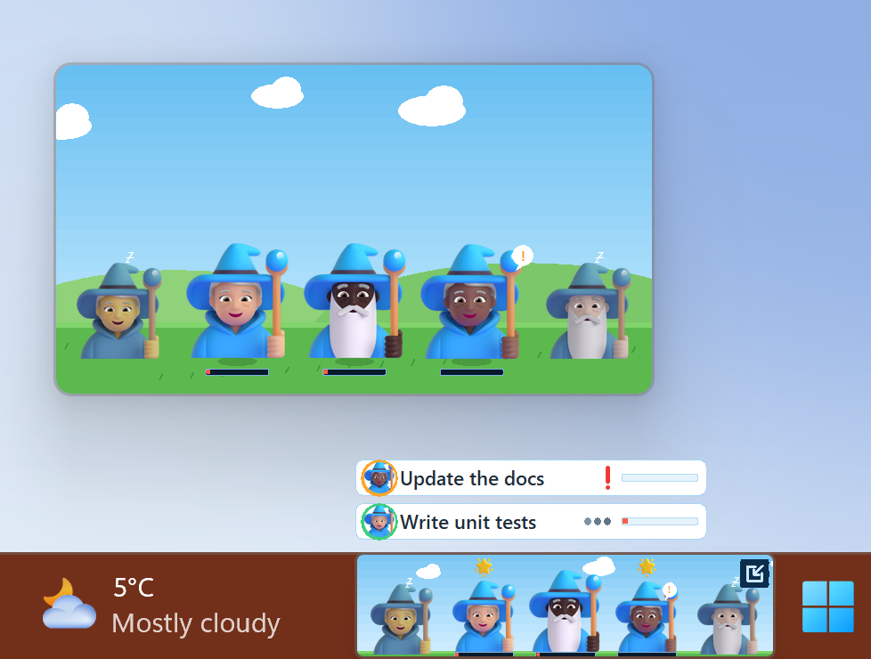

# Agent Desk

[](https://github.com/augboz/agent-desk/actions/workflows/ci.yml)


[](LICENSE)

A small Windows 11 widget for [Claude Code](https://code.claude.com). Each of
your recent Claude Code chats shows up as a character living on your taskbar.
It sleeps while the chat is idle and wakes up and works while Claude is busy.
A progress bar fills as Claude ticks off its task list, and a "!" pops up when
Claude needs your answer.



> [!IMPORTANT]
> **Bring your own characters.** The wizards above (and the skiers and animals)
> are only basic placeholders. Each has a single picture, so "asleep" is just the
> same picture dimmed. Agent Desk is meant to be used with your own **awake**
> and **asleep** pictures (your favourite characters, your friends, your
> team), and it looks far better that way. It takes a couple of minutes; see
> [Your own characters](#your-own-characters), or right-click the strip →
> **Use your own pictures…**.

## Features

- **Lives on the taskbar.** A strip fills the empty space between the
  Widgets (weather) button and the Start button. It hides when a full-screen
  app is in front.
- **Your 5 most recent chats**, ranked by the last message *you* typed.
  This includes chats the desktop app has closed in the background. A
  scheduled task's automatic runs don't count. A new chat takes the spot of
  the one you texted longest ago, so the others never move.
- **See what each chat is doing at a glance:**
  - **Asleep**: idle.
  - **Awake, with a progress bar**: working.
  - **"!"**: waiting for you.
  - **Small fish** (in the Fish theme): a subagent that's running.
- **Status cards.**
  - Hover a creature to preview its card.
  - Click it to pin the card in a stack above the strip, with a star over its
    head; click again to unpin.
  - Each card shows the chat's name, its state (drifting z's, softly glowing
    dots, or ❗) and a progress bar.
- **A bigger window.** The icon in the strip's top-right corner opens a larger
  scene that works the same way. You can drag it, resize it, and right-click it
  for options.
- **Characters.** Pick a theme with right-click → **Characters**: Wizards,
  Skiers, Animals, drawn Fish, or **My own pictures**. The built-in themes are
  basic placeholders; your own pictures are the real thing.

## Install

You need Windows 11 and Python 3.12 or newer (with tkinter, which the
python.org installer includes).

```bash
git clone https://github.com/augboz/agent-desk.git
cd agent-desk
python -m pip install -r requirements.txt   # optional: Pillow, for picture characters
```

Then double-click **`Agent Desk.cmd`**, or run `pythonw agent_desk.py`.
Starting it a second time does nothing. To try it without Claude Code, run
`python agent_desk.py --demo`, which shows made-up chats that change state.

**Start with Windows:** right-click the strip, then tick **Start with Windows**.
This adds a shortcut to your Startup folder (open it with Win+R →
`shell:startup`). Untick it to remove the shortcut.

**Quit:** right-click → **Quit Agent Desk**.

## Your own characters

**This is how Agent Desk is meant to be used.** The built-in themes are only
there so it works out of the box. It takes two steps, with no settings file
and no command line:

1. Right-click the strip → **Use your own pictures…**. This opens the
   `character-sources` folder. Drop your pictures in, in either of two ways:

   | Per character | Name the files like | Asleep looks like |
   | --- | --- | --- |
   | **One picture** | `fox.png` | the same picture, greyed out a bit |
   | **Two pictures** (best) | `fox awake.png` and `fox asleep.png` | your asleep picture |

   - `_awake` / `-asleep` / `sleeping` work too.
   - The file name is the character's name.
   - Up to 5 characters show at once.
2. Right-click → **Characters** → **My own pictures**.

That's it. Add, change or remove pictures any time and the strip updates by
itself within a few seconds.

- **Formats:** PNG, JPG, WEBP, BMP or GIF.
- **Backgrounds:** a transparent background is used as it is, and a plain
  white one is cut away. Anything else is kept as a rectangle.
- **Faces:** the round face on the status cards comes from the top of the
  awake picture.

The pictures stay on your machine. Git ignores both `character-sources/` and
`characters/` (where the prepared pictures go), so they never end up in a
commit. If you share your pictures, only share ones you have the rights to.

<details>
<summary>Advanced: halves of a picture, face crops, size tweaks</summary>

Put a `characters.json` in the folder (copy
[`characters.example.json`](characters.example.json)) to:

- use `"file.png:L"` / `"file.png:R"`, the left or right half of one picture;
- set a `face` (a square crop box);
- add a `scale` tweak;
- set a stricter `bg_min` for white backgrounds.

You can also run `python make_characters.py [folder]` from a terminal.

</details>

## Privacy and security

- **Read-only.** Agent Desk only reads Claude Code's local files, and never
  changes, uploads or logs what's in them.
- **No network.** It never connects to the internet.
- **No logins.** It never touches your credentials.
- **No setup changes.** It doesn't install hooks or edit Claude Code's
  settings.
- **What it writes:** only its own settings and an error log, both in
  `%APPDATA%\AgentDesk`.

See [SECURITY.md](SECURITY.md) for everything it reads, writes and starts,
and for how to report a problem.

## How it works

Every 1.5 seconds, on a background thread so the animation never stutters, it
reads:

| What | Where |
| --- | --- |
| Running sessions, and whether each one is busy | `~/.claude/sessions/<pid>.json` (checked against the live process) |
| Recent chats, their titles, your last message, task-list progress | `~/.claude/projects/*/<session>.jsonl` (only the new part of each file) |
| Subagents | `~/.claude/projects/*/<session>/subagents/agent-*.jsonl` |

The taskbar layout comes from `taskbar_layout.ps1`, a small read-only UI
Automation helper. It finds the Widgets and Start buttons so the strip
never covers them.

> **Heads-up:** these files are internal to Claude Code. They aren't a
> documented or stable interface, so a Claude Code update can change them.
> Odd or unexpected content is skipped rather than crashing the app. If the
> strip ever looks empty, run `python detect.py` to see what Agent Desk can
> find, and please open an issue.

## Development

```bash
python -m pip install -r requirements-dev.txt
python -m pytest        # tests, including a quick smoke test that opens the windows
python -m ruff check .  # lint
```

| File | What it does |
| --- | --- |
| `agent_desk.py` | The app: starts everything, saves settings |
| `taskbar_strip.py` | The strip on the taskbar |
| `desk_window.py` | The big window, the demo chats, the error log |
| `cards.py` | Status cards and the pinned-card stack |
| `cast.py` | Picture characters: who gets which spot |
| `scenes.py` | The drawn scenes (aquarium and others) |
| `detect.py`, `progress.py` | Reading Claude Code's session files |
| `make_characters.py` | Turns your pictures into characters |
| `themes/`, `tools/build_themes.py` | The basic built-in themes, and the script that makes them |
| `prototypes.py` | The other scene ideas side by side (`Prototypes.cmd`) |

## Licence

[MIT](LICENSE).

The built-in Wizards, Skiers and Animals themes are made from
[Microsoft Fluent Emoji](https://github.com/microsoft/fluentui-emoji), used
under the MIT licence; see
[`themes/LICENSE-fluent-emoji.txt`](themes/LICENSE-fluent-emoji.txt).

Agent Desk is an independent, unofficial project. It is not affiliated with,
endorsed by, or sponsored by Anthropic, PBC. "Claude" and "Claude Code" are
trademarks of Anthropic, PBC.
